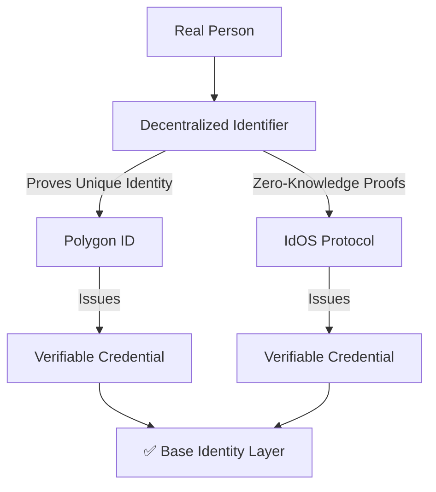
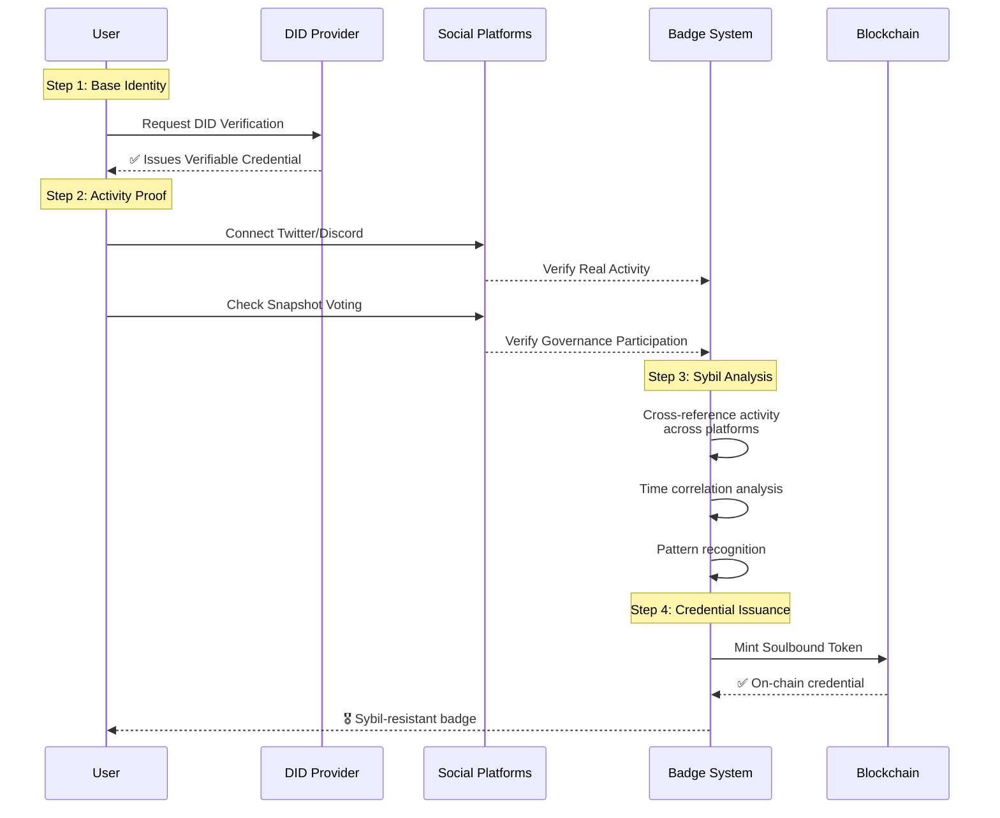
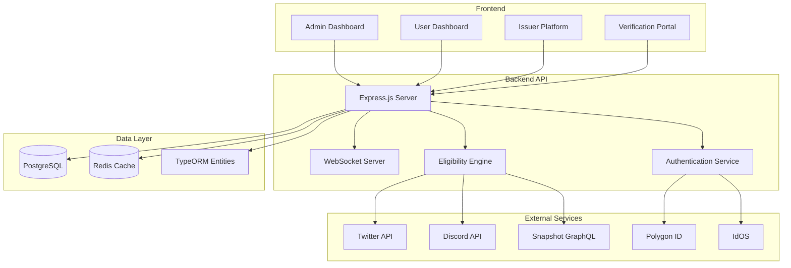

# 🎖️ Badge Verification System


**Sybil-resistant credential platform combining DID authentication with social verification for web3 identity proof.**

> A decentralized identity system that uses **DID verification** (Polygon ID/IdOS) as primary identity and **social verification** as secondary proof of human activity, creating robust sybil-resistant credentials.

---

## 🎯 **The Problem We Solve**

### **The Identity Trilemma in Web3**
Current solutions fail at one or more:
1. **Privacy-invasive**: KYC exposes personal data
2. **Centralized**: Relies on trusted third parties  
3. **Sybil-vulnerable**: Easy to create fake identities

### **Sybil Attacks Are Everywhere**
- 🚫 **Governance farming**: Fake accounts manipulate DAO votes
- 🚫 **Airdrop draining**: One person claims multiple rewards  
- 🚫 **Community dilution**: Bots overwhelm genuine discussion

---

## 🛡️ **Our Solution: Layered Identity Verification**

### **Layer 1: DID Authentication (Primary Identity)**

---
## **🏗️ How It Works: Complete Flow**

---
## 📋 Table of Contents

- [✨ Features](#-features)
- [🏗️ Architecture](#️-architecture)
- [🚀 Quick Start](#-quick-start)
- [🔧 Configuration](#-configuration)
- [📁 Project Structure](#-project-structure)
- [🔌 API Endpoints](#-api-endpoints)
- [🎮 Demo](#-demo)
- [🤝 Social Verification](#-social-verification)
- [🛠️ Development](#️-development)
- [🧪 Testing](#-testing)
- [📈 Deployment](#-deployment)
- [🤔 FAQ](#-faq)
- [📄 License](#-license)

---

## ✨ Features

### 🎯 Core Features
- **DID Authentication**: Polygon ID & IdOS integration (stub/real modes)
- **Real-time Notifications**: WebSocket events for minting/verification
- **Badge Ecosystem**: Create, manage, and issue verifiable badges
- **Eligibility Engine**: Rule-based verification with AND/OR logic
- **Multi-tenant Platform**: Separate issuer dashboards with analytics

### 👥 User Management
- **SIWE Authentication**: Sign-In with Ethereum (EIP-4361)
- **Admin Dashboard**: Full user management with search & pagination
- **User Profiles**: Personal dashboards with badge galleries
- **Achievement System**: Progress tracking and milestones

### 🔗 Social Verification
- **Twitter OAuth 2.0**: Follow verification with PKCE flow
- **Discord OAuth 2.0**: Account connection and verification
- **Snapshot Integration**: Real DAO voting verification via GraphQL API
- **Mock Services**: On-chain activity and governance (ready for real APIs)

### 🏢 Issuer Platform
- **Self-service Onboarding**: Create issuer profiles in minutes
- **Visual Badge Creator**: Template-based badge creation
- **Dynamic Rule Configuration**: Configure verification rules per project
- **Real-time Analytics**: Track badge issuance and user engagement

---

## 🏗️ Architecture



---

## 🚀 Quick Start

### Prerequisites
- Node.js 18+ & npm
- PostgreSQL 14+
- Redis 6+
- Git

### Installation

No external accounts or API keys are required to run this locally — DID
verification and on-chain minting run in mock mode by default, and the
default `.env.example` values work as-is.

```bash
# Clone the repository
git clone https://github.com/macjayz/badge-verification.git
cd badge-verification

# Start Postgres & Redis
docker-compose up -d

# Install dependencies
npm install

# Set up environment variables (defaults already match docker-compose)
cp .env.example .env

# Start the dev server (schema auto-syncs against the empty DB)
npm run dev
```

The server listens on `http://localhost:3000` (or `PORT` in `.env`). Open
[http://localhost:3000/user-login.html](http://localhost:3000/user-login.html)
or [http://localhost:3000/admin-login.html](http://localhost:3000/admin-login.html)
(`admin` / `admin123`, dev-only default — see [Configuration](#-configuration))
to explore the UI. The database starts empty, so use the Admin/Issuer
dashboards to create an issuer and a badge type before testing eligibility
and minting.

For a production-style run instead of hot reload:

```bash
npm run build
npm start
```

---

## 🔧 Configuration

### Environment Variables

`.env.example` in the repo root has working defaults for everything below —
copy it to `.env` and you're done. Only the CORE block is required to run
the app; everything else is OPTIONAL and only needed if you want to
exercise real social/DID/on-chain verification instead of mock mode.

```env
# --- CORE (required) ---
NODE_ENV=development
PORT=3000

DB_HOST=localhost
DB_PORT=5433              # matches docker-compose.yml
DB_USERNAME=postgres
DB_PASSWORD=postgres
DB_NAME=badgedb

REDIS_URL=redis://localhost:6380   # matches docker-compose.yml

JWT_SECRET=dev-only-secret-change-me
ALLOWED_ORIGINS=http://localhost:3000,http://localhost:3001

USE_REAL_ADAPTERS=false   # true only once the OPTIONAL keys below are filled in

# --- OPTIONAL: social verification ---
# TWITTER_CLIENT_ID=your_twitter_client_id
# TWITTER_CLIENT_SECRET=your_twitter_client_secret
# TWITTER_REDIRECT_URI=http://localhost:3000/api/verify/twitter/callback
# DISCORD_CLIENT_ID=your_discord_client_id
# DISCORD_CLIENT_SECRET=your_discord_client_secret
# DISCORD_REDIRECT_URI=http://localhost:3000/api/verify/discord/callback

# --- OPTIONAL: on-chain minting (Sepolia/Mumbai testnets only) ---
# CONTRACT_ADDRESS=
# SEPOLIA_RPC_URL=
# DEPLOYER_PRIVATE_KEY=      # a dedicated testnet-only key, never one holding real funds
```

> **Never commit a real `.env`.** An earlier revision of this repo
> accidentally committed one with live API keys and a deployer private key;
> those credentials have been rotated and history has been scrubbed. If
> you forked or cloned this repo before that cleanup, treat any keys you
> may have pulled as compromised.

### Database Setup

The dev server (`npm run dev`) uses TypeORM's `synchronize: true` in
development, so the schema is created automatically on first boot — no
manual migration step is needed for local testing.

If you're running against a non-Docker Postgres instance:

```bash
createdb badgedb
npm run migration:run   # applies src/migrations/
```

**In production the schema is _not_ created automatically** — running the
migration is a required deployment step. See [Deployment](#-deployment).

---

## 📁 Project Structure

```
badge-backend/
├── src/
│   ├── config/           # Configuration management
│   ├── db/              # Database connection & migrations
│   ├── entities/        # TypeORM entities
│   │   ├── User.ts
│   │   ├── Verification.ts
│   │   ├── BadgeType.ts
│   │   ├── Issuer.ts
│   │   └── UserSocialConnection.ts
│   ├── services/        # Business logic
│   │   ├── eligibility.service.ts    # Rule engine
│   │   ├── twitter.service.ts        # Twitter OAuth
│   │   ├── discord.service.ts        # Discord OAuth
│   │   ├── snapshot.service.ts       # Snapshot API
│   │   ├── websocket.service.ts      # Real-time notifications
│   │   └── minting.service.ts        # Badge issuance
│   ├── controllers/     # API endpoints
│   ├── middleware/      # Auth & validation
│   ├── adapters/        # DID provider adapters
│   ├── routes/          # Express routes
│   └── index.ts         # Application entry point
├── public/              # Frontend HTML files
│   ├── admin-dashboard.html
│   ├── user-dashboard.html
│   ├── user-verifications.html
│   └── issuer-dashboard.html
├── scripts/             # Development & deployment scripts
├── tests/               # Test suites
└── docker/              # Docker configurations
```

---

## 🔌 API Endpoints

### Authentication
- `POST /api/auth/siwe` - Sign-In with Ethereum
- `POST /api/admin/auth/login` - Admin login
- `POST /api/auth/refresh` - Refresh JWT token

### User Management
- `GET /api/user/profile` - Get user profile
- `GET /api/user/verifications` - List user verifications
- `POST /api/user/complete-verification` - Complete verification

### Badge Management
- `GET /api/eligibility/:wallet` - Check badge eligibility
- `POST /api/mint` - Mint a badge
- `GET /api/badges` - List available badges

### Social Verification
- `POST /api/verify/twitter/oauth/initiate` - Start Twitter OAuth
- `GET /api/verify/twitter/callback` - Twitter OAuth callback
- `POST /api/verify/discord/oauth/initiate` - Start Discord OAuth
- `POST /api/verify/snapshot/verify` - Verify Snapshot votes

### Admin Endpoints
- `GET /api/admin/users` - List users (paginated)
- `PUT /api/admin/users/:id` - Update user status
- `POST /api/admin/badges` - Create new badge type
- `GET /api/admin/analytics` - System analytics

### WebSocket
- `ws://localhost:3000` - Real-time events
- Events: `badge_minted`, `verification_completed`, `eligibility_updated`

---

## 🎮 Demo

check screenshots here - https://github.com/macjayz/badge-verification/tree/main/screenshots

### Live Demo URLs (when running locally)

| Page | URL | Description |
|------|-----|-------------|
| Admin Dashboard | http://localhost:3000/admin-dashboard.html | System administration |
| User Login | http://localhost:3000/user-login.html | User authentication |
| User Dashboard | http://localhost:3000/user-dashboard.html | User badge management |
| Verification Portal | http://localhost:3000/user-verifications.html | Social verification |
| Issuer Dashboard | http://localhost:3000/issuer-dashboard.html | Badge issuer platform |
| WebSocket Test | http://localhost:3000/websocket-demo.html | Real-time events test |

### Default Test Accounts

```javascript
// Admin User (dev-only hardcoded default, see src/controllers/admin-auth.controller.ts)
Username: admin
Password: admin123
```

For SIWE (Sign-In with Ethereum) testing, use any wallet you control on a
testnet, or run a local chain and use one of its throwaway accounts:

```bash
npx hardhat node   # prints funded local test accounts + private keys
```

Never reuse an account printed by `hardhat node` (or any other "test"
private key) for anything holding real funds.

---

## 🤝 Social Verification

### Twitter Integration
**Features:**
- OAuth 2.0 with PKCE security
- User account connection
- Follow verification (with bypass logic for Standalone Apps)
- Rate limit handling with automatic retry

**Note:** Due to Twitter API limitations for Standalone Apps, follow verification uses a bypass logic that marks users as "Connected" rather than fully verified. This can be upgraded to full verification by attaching the app to a Twitter Developer Project.

### Discord Integration
**Features:**
- Standard OAuth 2.0 flow
- User account connection
- Basic user information retrieval
- Ready for server membership verification (requires bot token)

### Snapshot Integration
**Features:**
- Real GraphQL API integration (no mock mode)
- Voting history verification
- Space/proposal filtering
- Timeframe-based verification
- Always creates verification records (success/failure)

### Mock Services
- **On-chain Activity**: Random transaction count (0-20)
- **On-chain Governance**: Random participation check
- **Generic Verification**: Fallback for unsupported methods

---

## 🛠️ Development

### Available Scripts

```bash
# Development
npm run dev              # Start with hot reload
npm run build            # Build TypeScript
npm start                # Start production server (after build)

# Database
npm run migration:run       # Apply migrations (from TS sources)
npm run migration:run:prod  # Apply migrations (from compiled dist/)
npm run migration:generate src/migrations/YourChange  # Diff entities -> new migration
npm run migration:revert    # Roll back the last migration
npm run typeorm -- <command>  # TypeORM CLI

# Contracts (Hardhat)
npm run compile          # Compile contracts
npm run test:contract    # Run contract tests
npm run deploy:sepolia   # Deploy to Sepolia (needs OPTIONAL blockchain env vars)

# Testing
npm test                 # Run Jest tests
```

Code quality tools (`eslint`, `prettier`) are installed as dev dependencies
but not yet wired up as npm scripts — run them directly with
`npx eslint .` / `npx prettier --write .`.

### Adding New Verification Methods

1. Create a new service in `src/services/`:
```typescript
export class NewService {
  async verify(wallet: string, params: any) {
    // Implementation
  }
}
```

2. Update `eligibility.service.ts`:
```typescript
case 'new_method':
  return await newService.verify(wallet, rule.params);
```

3. Add to badge rules configuration:
```json
{
  "method": "new_method",
  "required": true,
  "params": { /* method-specific params */ }
}
```

### Debugging

```bash
# Enable debug logging
DEBUG=badge-backend:* npm run dev

# Test specific endpoints
curl http://localhost:3000/health
curl http://localhost:3000/api/user/verifications

# Database inspection
npm run db:info
npm run db:tables
```

---

## 🧪 Testing

### Test Structure

```
tests/
├── unit/              # Unit tests
│   ├── services/     # Service layer tests
│   └── controllers/  # Controller tests
├── integration/      # Integration tests
│   ├── api/         # API endpoint tests
│   └── db/          # Database tests
└── e2e/             # End-to-end tests
    ├── auth/        # Authentication flows
    └── badges/      # Badge issuance flows
```

### Running Tests

```bash
# Run all tests
npm test

# Run specific test suites
npm run test:unit
npm run test:integration
npm run test:e2e

# Run with coverage
npm run test:coverage

# Watch mode for development
npm run test:watch
```

### Test Data

Use the provided test scripts:

```bash
# Create test users
node scripts/create-test-users.js

# Test Twitter flow
node scripts/test-twitter-complete-flow.js

# Test Snapshot integration
node scripts/test-snapshot-api.js

# Debug eligibility engine
node scripts/debug-eligibility.js
```

---

## 📈 Deployment

### Important: schema is not auto-created in production

In development the app auto-syncs the database schema on boot. In production
that is switched off, so **you must run the migration once** or the app will
start against an empty database and every request will fail:

```bash
npm run migration:run:prod    # compiled build (dist/)
npm run migration:run         # from TypeScript sources
```

### Required environment variables

The app **refuses to start** in production unless these are set to
non-default values — this is deliberate, so a deploy can't silently go live
with a public signing key or a public admin password:

| Variable | Requirement |
|----------|-------------|
| `NODE_ENV` | `production` |
| `JWT_SECRET` | Not the dev default, at least 32 chars (`openssl rand -base64 48`) |
| `ADMIN_PASSWORD` | Not `admin123` |
| `ADMIN_USERNAME` | Optional, defaults to `admin` |
| `DB_HOST` / `DB_PORT` / `DB_USERNAME` / `DB_PASSWORD` / `DB_NAME` | Your database |
| `DATABASE_URL` | Alternative to the five `DB_*` values above — if set, it wins. Most managed Postgres providers give you this. |
| `DB_SSL` | `true` for hosted Postgres (Render, Railway, Heroku, Neon, Supabase all require TLS) |
| `DB_SSL_REJECT_UNAUTHORIZED` | `false` only if your provider uses a private CA and you hit `self-signed certificate in certificate chain` |
| `REDIS_URL` | Your Redis instance |
| `ALLOWED_ORIGINS` | Comma-separated origins allowed by CORS |

### Option 1: Docker Compose (whole stack)

```bash
cp .env.example .env
# edit .env: set JWT_SECRET and ADMIN_PASSWORD to real values

docker compose -f docker-compose.prod.yml up -d --build
docker compose -f docker-compose.prod.yml run --rm app npm run migration:run:prod
```

App is then on `http://localhost:3000`. (`docker-compose.yml` without `-f`
remains the development file that starts only Postgres and Redis.)

### Option 2: Docker image against your own database

```bash
docker build -t badge-backend:latest .
docker run -d --name badge-backend -p 3000:3000 --env-file .env badge-backend:latest
docker exec badge-backend npm run migration:run:prod
```

The image is multi-stage (dev dependencies are pruned) and runs as the
unprivileged `node` user. It logs to stdout, so `docker logs` works normally.

### Option 3: VPS / PaaS (Render, Railway, Fly, etc.)

```bash
npm ci
npm run build
npm run migration:run:prod
npm start                     # or: pm2 start dist/index.js --name badge-backend
```

Set the environment variables from the table above in your platform's
dashboard. The server binds `0.0.0.0` and honours `PORT`, so managed
platforms route to it without extra configuration.

### Not included

To be explicit about what this repo does **not** ship, so you don't go looking:
no Kubernetes manifests, no nginx/TLS config, no serverless packaging, no
rate limiting, and no Sentry/APM wiring. There is also no automated test
suite yet.

---

## 🤔 FAQ

### Q: Why does Twitter verification use bypass logic?
**A:** Twitter's API has strict limitations for Standalone Apps (cannot access friendships API). The bypass logic marks users as "Connected" rather than "Verified" and provides a clear path to upgrade to full verification by attaching the app to a Twitter Developer Project.

### Q: Can I use real DID providers instead of stubs?
**A:** Yes! Set `USE_REAL_ADAPTERS=true` in your environment variables and configure the respective provider credentials.

### Q: How do I create custom badge rules?
**A:** Use the issuer dashboard or directly configure badge rules in the database. Rules support AND/OR logic and can combine multiple verification methods.

### Q: Is this ready for production?
**A:** The architecture is production-ready. You'll need to:
1. Configure production environment variables
2. Set up proper monitoring and logging
3. Implement rate limiting
4. Set up backup procedures
5. Conduct security audit

### Q: How do I add new social verification methods?
**A:** Follow the pattern in `src/services/` - create a new service class, add it to the eligibility engine, and update the frontend verification portal.

### Q: Can this issue real blockchain badges?
**A:** Yes! The Web3 service is configured for development with Hardhat. Replace with real contract addresses and RPC URLs for production deployment.

---

## 📄 License

MIT License

Copyright (c) 2024 Badge Verification System

Permission is hereby granted, free of charge, to any person obtaining a copy
of this software and associated documentation files (the "Software"), to deal
in the Software without restriction, including without limitation the rights
to use, copy, modify, merge, publish, distribute, sublicense, and/or sell
copies of the Software, and to permit persons to whom the Software is
furnished to do so, subject to the following conditions:

The above copyright notice and this permission notice shall be included in all
copies or substantial portions of the Software.

THE SOFTWARE IS PROVIDED "AS IS", WITHOUT WARRANTY OF ANY KIND, EXPRESS OR
IMPLIED, INCLUDING BUT NOT LIMITED TO THE WARRANTIES OF MERCHANTABILITY,
FITNESS FOR A PARTICULAR PURPOSE AND NONINFRINGEMENT. IN NO EVENT SHALL THE
AUTHORS OR COPYRIGHT HOLDERS BE LIABLE FOR ANY CLAIM, DAMAGES OR OTHER
LIABILITY, WHETHER IN AN ACTION OF CONTRACT, TORT OR OTHERWISE, ARISING FROM,
OUT OF OR IN CONNECTION WITH THE SOFTWARE OR THE USE OR OTHER DEALINGS IN THE
SOFTWARE.

---

## 🙏 Acknowledgments

- **Ethereum Foundation** for SIWE standard
- **Snapshot** for their excellent GraphQL API
- **Twitter Developer Platform** for OAuth 2.0 implementation
- **Discord** for their developer-friendly API
- **TypeORM & Express.js** communities for excellent documentation

---

## 📞 Support & Contact

For questions, issues, or contributions:

- **X**: https://x.com/koinfidential
- **GitHub Issues**: [Report a bug or request a feature](https://github.com/macjayz/badge-verification/issues)
- **Documentation**: Check the `/docs` folder for detailed guides
- **Community**: Join our Discord community for discussions

---

**⭐ If you find this project useful, please give it a star on GitHub!**

---

*Last Updated: December 2024 | Version: 1.0.0 | Status: Production Ready*
