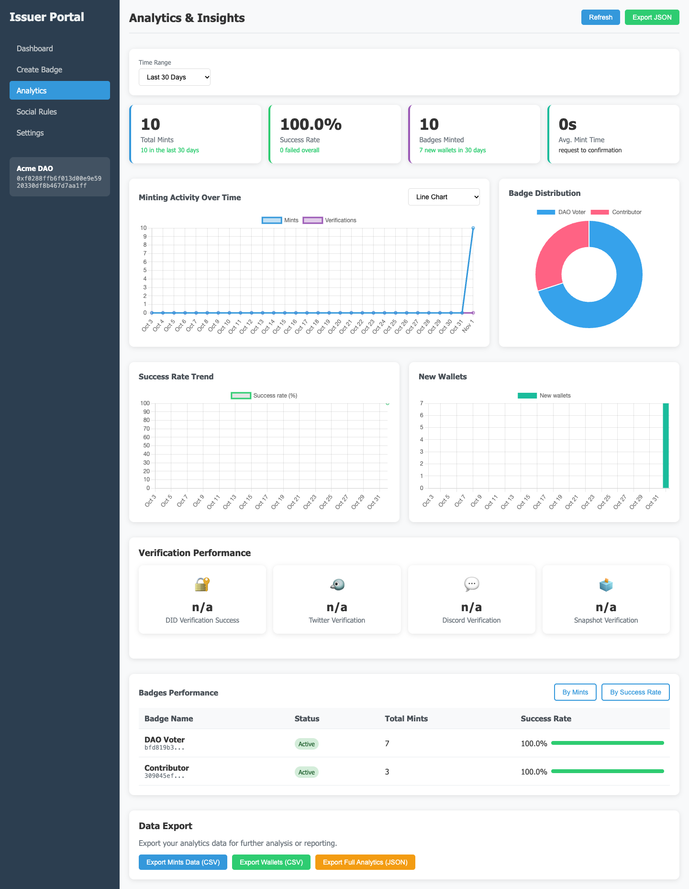

# Badge Verification

A backend and web UI for issuing soulbound badges only to wallets that pass the issuer's checks.
Issuers define the rules for each badge: proof of a unique identity through Privado ID (formerly
Polygon ID), plus social and on-chain checks such as
following an X account, membership of a Discord server, Snapshot votes or a minimum number of
transactions. A wallet that passes is minted a non-transferable ERC-721 token.

The aim is Sybil resistance for airdrops, governance and community access without collecting
personal data: the identity proof is a credential the user holds, not a KYC upload.



## How it works

1. A user signs in with their wallet (Sign-In with Ethereum, EIP-4361).
2. They prove their identity by scanning a QR code with the Privado ID wallet, which sends a
   zero-knowledge proof of a credential (by default: a KYC credential showing they are over 18)
   to Privado's verifier. They also connect the social accounts a badge needs (X and Discord
   through OAuth 2.0 with PKCE).
3. The eligibility engine evaluates the badge's rules: the identity check, then each social or
   on-chain check, which can be required or optional.
4. If the wallet qualifies, the backend mints the badge from `contracts/BadgeSBT.sol` and pushes
   progress to the browser over a WebSocket.

The contract is a soulbound ERC-721: every badge is permanently locked (ERC-5192), transfers and
approvals revert, and `tokenURI` returns the metadata URI of the badge's type. The owner can pause
minting of a badge type or change its metadata, which emits an ERC-4906 refresh event.

Checks fail closed. An unreachable API or an X API plan without follow lookups counts as "not
met", never as a pass, and badge rules naming a check the server does not support are rejected
when they are saved. One identity can verify only one wallet.

| Check | Method | Source |
| --- | --- | --- |
| Identity | `privadoid` | Privado ID verifier backend; the DID comes from the wallet's signed response |
| X follow | `twitter_follow` | X API v2, through the user's OAuth connection |
| Discord membership | `discord_member` | The user's guild list (`guilds` OAuth scope) |
| Snapshot votes | `snapshot_votes` | Snapshot GraphQL API |
| On-chain activity | `onchain_activity` | Transaction count from the configured chain's RPC |

## Stack

- **API:** Node.js 22, TypeScript, Express, TypeORM, PostgreSQL, Redis, `ws`
- **Contract:** Solidity 0.8.20 on OpenZeppelin 5, with Hardhat for builds and tests
- **UI:** static HTML pages in `public/` for users, issuers and admins, with Chart.js for charts
- **Tests:**
  - Jest and Supertest for the API: auth, access control, eligibility rules, config guards and WebSocket authorization
  - Hardhat tests for the contract

## Running locally

Local development needs no wallet, API keys or chain. With `USE_REAL_ADAPTERS=false`, the
identity check and minting are simulated: the QR code appears, and the session verifies on the
first poll. Set `USE_REAL_ADAPTERS=true` to use the live Privado ID verifier instead.

```bash
npm install
cp .env.example .env
docker compose up -d          # Postgres on 5433, Redis on 6380
npm run dev
```

Open <http://localhost:3000>. In development the login page offers a demo wallet, and the admin
panel at `/admin-login` accepts the default `admin` / `admin123`. To try the issuer side,
register an issuer:

```bash
curl -X POST localhost:3000/api/issuer/register \
  -H 'content-type: application/json' \
  -d '{"name":"Acme DAO","wallet":"0x0000000000000000000000000000000000000001"}'
```

Then sign in at `/issuer-login` with the returned API key, and create badges and rules there.

| Command | What it does |
| --- | --- |
| `npm test` | API tests |
| `npm run test:contract` | Contract tests |
| `npm run lint` | ESLint |
| `npm run typecheck` | TypeScript check |
| `npm run build` | Compile to `dist/` |

## Deploying

Production refuses to start unless all of these are set:
- `JWT_SECRET`: at least 32 characters
- `ADMIN_PASSWORD`: not the development default
- `USE_REAL_ADAPTERS=true`
- `DEPLOYER_PRIVATE_KEY` and `CONTRACT_ADDRESS`
- `PRIVADO_ALLOWED_ISSUERS`: the issuer DIDs whose credentials you accept. `*` is refused, because
  anyone can issue themselves a credential.

This means a misconfigured deploy fails at boot instead of minting simulated badges or accepting
self-issued identities.

1. Deploy the contract and note its address:

   ```bash
   DEPLOYER_PRIVATE_KEY=0x... npm run deploy:base-sepolia
   ```

   Other networks are configured in `hardhat.config.ts`. The deploying key becomes the contract
   owner, which is the only account that can mint or revoke.

2. Fill in `.env` from `.env.example`, then start the stack and apply the schema:

   ```bash
   docker compose -f docker-compose.prod.yml up -d --build
   docker compose -f docker-compose.prod.yml run --rm app npm run migration:run:prod
   ```

   Migrations are a separate step rather than part of boot, so a crash-looping container cannot
   keep touching the schema.

The image runs as an unprivileged user and has a health check. `GET /health` returns 503 until
the database answers. On a managed host, set `DATABASE_URL` and `DB_SSL=true` instead of the
`DB_*` values.

## Configuration

`.env.example` documents every variable. The ones that change behaviour:

| Variable | Default | Effect |
| --- | --- | --- |
| `USE_REAL_ADAPTERS` | `false` | `false` simulates the identity check and mints, for local development only |
| `PRIVADO_ALLOWED_ISSUERS` | `*` | Comma-separated issuer DIDs whose credentials pass the identity check |
| `PRIVADO_CHAIN_ID` | `80002` | Chain the credentials are anchored on: `80002` (Polygon Amoy test network) or `137` (Polygon) |
| `PRIVADO_CREDENTIAL_TYPE`, `PRIVADO_CREDENTIAL_CONTEXT`, `PRIVADO_CREDENTIAL_SUBJECT` | KYC age, over 18 | The credential and query the wallet must prove |
| `DEFAULT_CHAIN_ID` | `31337` | Chain for minting and on-chain checks. Built-in RPC URLs cover 1, 11155111, 8453, 84532, 137 and 80002 |
| `RPC_URL` | | Overrides the RPC URL for `DEFAULT_CHAIN_ID` |
| `TWITTER_ACCEPT_CONNECTION_AS_FOLLOW` | `false` | On X API plans without follow lookups, accept a connected account in place of a verified follow |
| `ALLOWED_ORIGINS` | `http://localhost:3000` | CORS allow-list |

## API overview

| Area | Base path | Auth |
| --- | --- | --- |
| Wallet sign-in | `/api/auth` | Public |
| User data, eligibility, minting | `/api/user`, `/api/eligibility`, `/api/minting` | User JWT (eligibility by wallet is public) |
| DID and social verification | `/api/did`, `/api/verify/{twitter,discord,snapshot}` | User JWT (provider info and OAuth callbacks are public) |
| Issuer badges and rules | `/api/issuer`, `/api/issuer-dashboard` | `X-API-Key` |
| Issuer webhooks | `/api/webhooks` | `X-API-Key` |
| Admin | `/api/admin/*`, `/api/dashboard/admin/*` | Admin JWT |

Admins can suspend a user, which blocks both sign-in and minting, and can revoke a badge, which
burns the token on-chain. Webhooks for a verification go only to the issuer it was made for.

## Project layout

```
contracts/       BadgeSBT, the soulbound ERC-721
scripts/         Contract deployment and verification
src/
  adapters/did/  Privado ID adapter, plus a stub for local development
  controllers/   HTTP handlers
  services/      Eligibility engine, minting, OAuth, Snapshot, WebSocket events
  entities/      TypeORM models
  migrations/    Schema migrations
  routes/        Route wiring and auth middleware
public/          User, issuer and admin pages
test/            Contract tests
```

## Limitations

- The pages are server-rendered HTML with inline scripts, not a bundled frontend. Helmet's
  Content-Security-Policy is therefore off, so set one at your proxy.
- Follow checks need an X API plan that exposes follow lookups. Without one, X follow rules fail
  unless `TWITTER_ACCEPT_CONNECTION_AS_FOLLOW=true`.
- Revoking burns the token, and the contract will not mint the same badge type to that wallet
  again. A revoked badge still counts toward its type's supply.
- `tokenURI` is empty for badge types created without a metadata URI. `scripts/deploy.ts` sets one
  when `BADGE_METADATA_BASE_URL` is set; otherwise set it later with `setBadgeTypeMetadataUri`.
- The identity check is tested against Privado's live verifier up to "waiting for the wallet",
  and the success path is covered by unit tests. A full run with a real wallet proof has not been
  done yet.
- idOS is not supported. It integrates through its own SDKs and access grants, not a REST API.

## Security

Never commit a real `.env`. An early revision of this repository committed live keys; they were
rotated and removed from history. If you cloned it before then, treat those keys as compromised.

## License

MIT
